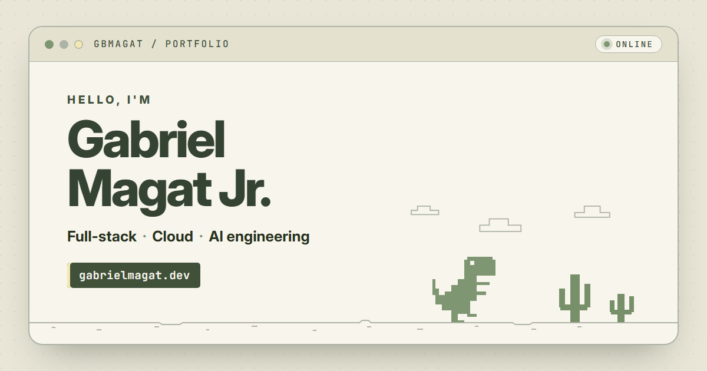

<p align="center">
  
</p>

# Portfolio — Gabriel B. Magat Jr.

My personal portfolio: projects, experience, skills, and contact details. It uses the same cream "browser window" desert look as my [GitHub profile](https://github.com/gbmagat), with a sage pixel dinosaur, cacti, and drifting clouds.

**Live site:** https://gbmagat.github.io/PORTFOLIO/

## What's inside

- **Projects** — JobFinder (my undergraduate thesis), Our Places, It's a Match, and MOPAC, each with a case study, live link, and source code
- **About, experience, and education** — freelance work, organization roles, and certifications
- **Tech stack** — badges that match my GitHub profile README
- **Chat** — a floating chat where visitors can ask quick questions or send me a message
- **Résumé page** — printable, with a one-click "Save as PDF"
- **Day and night themes** — follows your system setting, with a toggle
- Responsive layout, keyboard-friendly dialogs, reduced-motion support, and a custom 404 page

## Built with

Plain HTML, CSS, and JavaScript — no framework and no build step. Hosted on GitHub Pages.

## Run locally

Serve the folder with any static file server, for example:

```sh
python -m http.server 8000
```

Then open http://localhost:8000.

## Structure

```
index.html          Main page
resume.html         Printable résumé
404.html            Custom "page not found"
assets/css/         Styles (main.css, resume.css)
assets/js/          Interactions (main.js)
assets/img/         Icons, share image, and project screenshots
```

---

© Gabriel B. Magat Jr.
